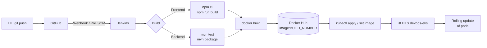

<div align="center">


<br/>


**Production-style 3-tier AWS platform — VPC, EKS, RDS MySQL and a Jenkins CI/CD server — provisioned end-to-end with modular Terraform.**

</div>

---

## 📑 Table of Contents

- [Overview](#-overview)
- [Live User Flow](#-live-user-flow)
- [Architecture](#-architecture)
- [CI/CD Pipeline](#-cicd-pipeline)
- [What Gets Created](#-what-gets-created)
- [Network Design](#-network-design)
- [Security Groups](#-security-groups)
- [IAM & Access](#-iam--access)
- [Project Structure](#-project-structure)
- [Getting Started](#-getting-started)
- [Outputs](#-outputs)
- [Security Notes & Hardening](#-security-notes--hardening)
- [Cleanup](#-cleanup)
- [Author](#-author)

---

## 🚀 Overview

This project builds the complete infrastructure for a containerised booking application (React frontend + Spring Boot backend + MySQL) on AWS.

| Item | Value |
|------|-------|
| Region | `ap-south-1` (Mumbai) |
| Terraform plan | **52 resources to add**, 0 to change, 0 to destroy |
| Kubernetes | Amazon EKS **1.34** |
| Worker nodes | Ubuntu 24.04 EKS AMI, `t3.medium`, ON_DEMAND, min 2 / desired 2 / max 3 |
| Database | RDS MySQL 8.0, `db.t3.micro`, 20 GB gp3, encrypted, **not publicly accessible** |
| CI/CD server | Jenkins on EC2 `t3.medium` with an SSM instance profile |
| Modules | `vpc`, `security_group`, `iam`, `eks`, `rds`, `Deployment_jenkins_ec2` |

---

## 🎬 Live User Flow


> Animated walkthrough: user → LoadBalancer → React/Nginx pod → Spring Boot pod (`:8080`) → RDS MySQL (`:3306`) → response back to the browser.
> Place the GIF at `docs/images/user-flow.gif`.

---

## 🏗 Architecture


---

## 🔄 CI/CD Pipeline



| Stage | Tooling |
|-------|---------|
| Source | GitHub (separate frontend and backend repos) |
| Trigger | Webhook or Poll SCM |
| Build | `npm ci && npm run build` (frontend), `mvn test && mvn package` (backend) |
| Package | Docker image tagged with the Jenkins build number |
| Registry | Docker Hub |
| Deploy | `kubectl` from Jenkins using an EKS access entry (`AmazonEKSClusterAdminPolicy`) |

---

## 📦 What Gets Created

<details>
<summary><b>Networking — module <code>vpc</code></b></summary>

- VPC `devops-vpc` — `10.0.0.0/16`
- Internet Gateway `terraform-vpc-igw`
- NAT Gateway `devops-vpc-nat-gateway` + Elastic IP `devops-vpc-nat-eip`
- Subnets: 1 public, 2 private, 2 database
- Route tables: public, private (default route via NAT), database
- 5 route table associations

</details>

<details>
<summary><b>Security — module <code>security_group</code></b></summary>

- `terraform-jenkins-sg`, `terraform-eks-cluster-sg`, `terraform-eks-node-sg`, `terraform-rds-sg`
- 13 ingress rules (see [Security Groups](#-security-groups))

</details>

<details>
<summary><b>IAM — module <code>iam</code></b></summary>

- Role `terraform-ssm-role` + instance profile `terraform-ssm-instance-profile`
- `AmazonSSMManagedInstanceCore` attachment
- Inline policies: `JenkinsBackendSSMDeployPolicy`, `jenkins-eks-describe-cluster`

</details>

<details>
<summary><b>Kubernetes — module <code>eks</code></b></summary>

- EKS cluster `devops-eks` (v1.34, `API_AND_CONFIG_MAP` auth, private + public endpoint)
- Cluster role `devops-eks-cluster-role` and node role `devops-eks-node-role`
- Policies: `AmazonEKSClusterPolicy`, `AmazonEKSWorkerNodePolicy`, `AmazonEKS_CNI_Policy`, `AmazonEC2ContainerRegistryPullOnly`
- Launch template (Ubuntu 24.04 EKS AMI read from SSM Parameter Store)
- Managed node group `devops-eks-node-group`
- Access entry + cluster-admin policy association for the Jenkins role

</details>

<details>
<summary><b>Database — module <code>rds</code></b></summary>

- DB subnet group `terraform-rds-subnet-group`
- RDS instance `devops-mysql` — database `bookingdb`, 7-day backups, storage encrypted

</details>

<details>
<summary><b>CI/CD server — module <code>Deployment_jenkins_ec2</code></b></summary>

- EC2 `deployment-Jenkins-ec2` (`t3.medium`, key pair `Dhadi`, AZ `ap-south-1a`)

</details>

---

## 🌐 Network Design

| Tier | Subnet | CIDR | AZ | Public IP |
|------|--------|------|----|-----------|
| Public | `terraform-public-subnet-1` | `10.0.1.0/24` | ap-south-1a | Yes |
| Private | `terraform-private-subnet-1` | `10.0.11.0/24` | ap-south-1a | No |
| Private | `terraform-private-subnet-2` | `10.0.12.0/24` | ap-south-1b | No |
| Database | `terraform-database-subnet-1` | `10.0.21.0/24` | ap-south-1a | No |
| Database | `terraform-database-subnet-2` | `10.0.22.0/24` | ap-south-1b | No |

---

## 🔐 Security Groups

| Security Group | Port | Source | Purpose |
|----------------|------|--------|---------|
| `terraform-jenkins-sg` | 22 | `0.0.0.0/0` | SSH to Jenkins |
| `terraform-jenkins-sg` | 8080 | `0.0.0.0/0` | Jenkins web UI |
| `terraform-eks-node-sg` | 80 | `0.0.0.0/0` | HTTP app traffic |
| `terraform-eks-node-sg` | 443 | `0.0.0.0/0` | HTTPS app traffic |
| `terraform-eks-node-sg` | 8080 | `10.0.0.0/16` | Backend traffic inside VPC |
| `terraform-eks-node-sg` | 443 | EKS cluster SG | Control plane → node |
| `terraform-eks-node-sg` | 10250 | EKS cluster SG | Control plane → kubelet |
| `terraform-eks-node-sg` | all | self | Node ↔ node |
| `terraform-eks-cluster-sg` | 443 | EKS node SG | Node → control plane |
| `terraform-rds-sg` | 3306 | EKS node SG | MySQL from EKS |
| `terraform-rds-sg` | 3306 | Jenkins SG | MySQL from Jenkins |

All security groups allow all outbound traffic.

---

## 🛡 IAM & Access

| Role | Used by | Permissions |
|------|---------|-------------|
| `terraform-ssm-role` | Jenkins EC2 | SSM Managed Instance Core, `ssm:SendCommand` on the backend instance and `AWS-RunShellScript`, `eks:DescribeCluster` on `devops-eks`, EKS cluster-admin via access entry |
| `devops-eks-cluster-role` | EKS control plane | `AmazonEKSClusterPolicy` |
| `devops-eks-node-role` | Worker nodes | Worker node, CNI, ECR pull-only |

---

## 📁 Project Structure

```text
.
├── main.tf                  # Root module — wires all modules together
├── variables.tf
├── outputs.tf
├── terraform.tfvars         # (git-ignored) environment values and secrets
├── docs/
│   └── images/
│       └── user-flow.gif    # Animated request/response flow
└── modules/
    ├── vpc/                 # VPC, subnets, IGW, NAT, route tables
    ├── security_group/      # Jenkins, EKS cluster/node and RDS security groups
    ├── iam/                 # SSM role, instance profile, inline policies
    ├── eks/                 # Cluster, node group, launch template, access entries
    ├── rds/                 # Subnet group and MySQL instance
    └── Deployment_jenkins_ec2/   # Jenkins EC2 instance
```

---

## ⚙️ Getting Started

### Prerequisites

- Terraform `>= 1.5`
- AWS CLI configured (`aws configure`) with permissions for VPC, EC2, EKS, RDS and IAM
- An existing EC2 key pair named `Dhadi` in `ap-south-1`
- `kubectl`

### Deploy

```bash
# 1. Clone
git clone https://github.com/<your-username>/<your-repo>.git
cd <your-repo>

# 2. Initialise providers and modules
terraform init

# 3. Validate and review the plan (52 resources)
terraform validate
terraform plan -out=tfplan

# 4. Apply the saved plan
terraform apply tfplan
```

### Connect to the cluster

```bash
aws eks update-kubeconfig --region ap-south-1 --name devops-eks
kubectl get nodes
kubectl get svc
```

---

## 📤 Outputs

| Output | Description |
|--------|-------------|
| `vpc_id` | ID of the created VPC |
| `vpc_cidr` | `10.0.0.0/16` |
| `frontend_sg_id` | Frontend / node security group ID |
| `backend_sg_id` | Backend security group ID |
| `database_sg_id` | Database security group ID |
| `rds_endpoint` | MySQL endpoint used by the backend |

---

## 🧰 Security Notes & Hardening

This stack is built for learning and demos. Before using it for production, consider:

- **Restrict SSH (22) and Jenkins (8080)** to your own IP instead of `0.0.0.0/0`.
- **Restrict the EKS public endpoint** with `public_access_cidrs`, or disable it and use a private endpoint.
- **Never commit** `terraform.tfvars` or `*.tfstate` — keep the DB credentials out of Git and store state in S3 with DynamoDB locking.
- **RDS:** enable `multi_az`, set `skip_final_snapshot = false` and `deletion_protection = true`.
- **High availability:** add a second public subnet and a NAT Gateway per AZ.
- **Least privilege:** replace the Jenkins cluster-admin access with a namespace-scoped policy.
- Consider fronting the app with an ALB + ACM certificate for HTTPS.

Suggested `.gitignore`:

```gitignore
.terraform/
*.tfstate
*.tfstate.*
*.tfvars
tfplan
crash.log
```

---

## 🧹 Cleanup

```bash
terraform destroy
```

> EKS, the NAT Gateway and RDS are billed hourly — destroy the stack when you are done.

---

## 👤 Author

**Ajay Dhadi** — AWS | DevOps | Cloud | Infrastructure as Code

[](https://github.com/)
[](https://www.linkedin.com/)

⭐ If this project helped you, give it a star!
